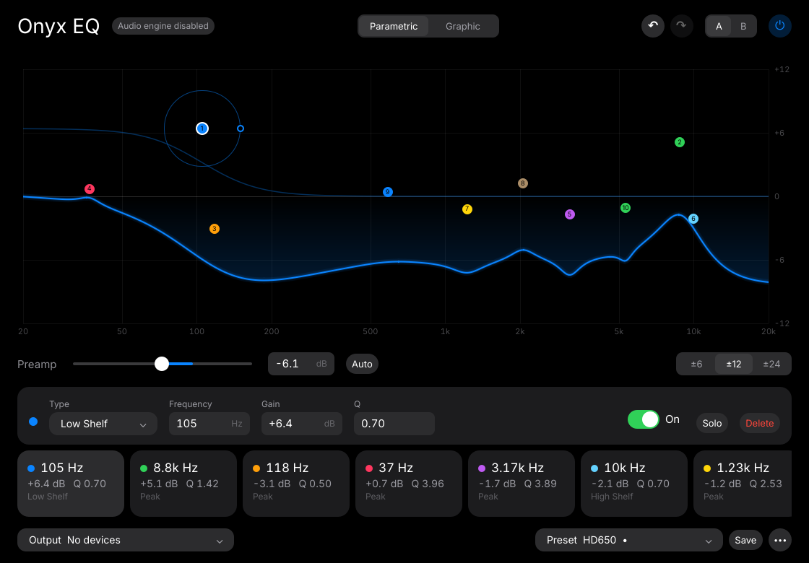
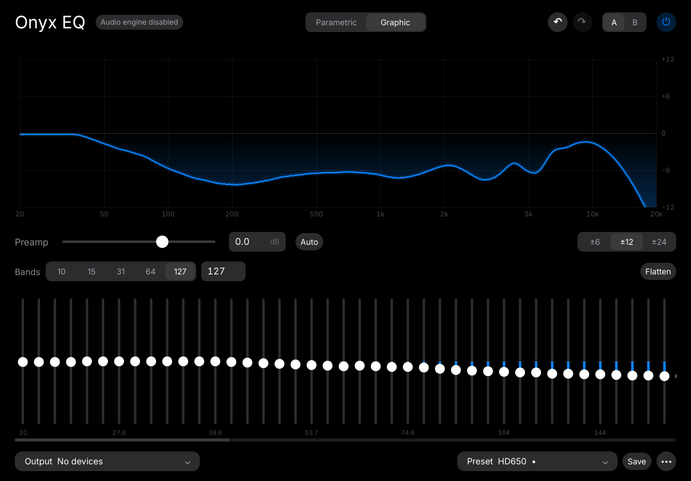

# Onyx EQ

A system-wide parametric and graphic equalizer for Linux, built on PipeWire, in the spirit of
Equalizer APO. Pure-black UI, unlimited bands, and Equalizer APO / AutoEQ import and export.



> **Experimental.** It works on the machine it was built on (PipeWire 1.4, KDE Plasma on Wayland).
> It hasn't been tested on GNOME, and nobody has listened carefully for clicks during very fast drags yet.
> Bug reports are welcome.

## How this was made

Onyx EQ was written by an AI model (Claude Opus 5.5, in Claude Code), not by hand. The author described
what annoyed them about existing Linux equalizers, Claude wrote the design spec ([`PLAN.md`](PLAN.md)),
and then built the app from that spec in one session of under an hour. That included checking
PipeWire's filter maths against its source, measuring the real audio output against the model, and
writing the tests.

If you want a mature, maintained equalizer for PipeWire, use
[EasyEffects](https://github.com/wwmm/easyeffects). This project is an experiment.

## Features

- **Parametric mode:** any number of bands. Drag points on a live frequency-response curve; the audio
  follows while you drag. Peak, low/high shelf, low/high pass, notch, band pass and all pass filters.
- **Graphic mode:** 10, 15, 31, 64, 127 or any custom number of bands. Drag across the sliders to paint
  a curve.
- **Equalizer APO and AutoEQ:** import `ParametricEQ.txt` / `GraphicEQ.txt` (or drop them on the
  window), and export either format.
- **Safe levels:** auto preamp and a clipping warning.
- Undo/redo, A/B compare, presets, and presets that switch automatically per output device.
- Optionally keeps running after the window closes, and starts at login (as a systemd user service).



## How it works

There's no custom audio code. Onyx EQ writes a PipeWire
[filter-chain](https://docs.pipewire.org/page_module_filter_chain.html) config and runs it as a
WirePlumber *smart filter* on your output device. Everything you play is routed through the EQ, but
your real device stays the default, so your desktop's volume slider works exactly as before. The EQ
follows whichever device is the default: plug in headphones and it moves with you, loading that
device's preset if you've set one.

Edits are applied live by changing the filter settings on the running chain, so there are no
restarts or dropouts. The curve you see is computed with the same formulas PipeWire uses. Measured
through PipeWire, it matches within 0.2 dB. Details are in [`docs/pipewire-notes.md`](docs/pipewire-notes.md).

When you quit (or if it crashes), audio goes straight to your device again.

## Install

**Requirements:** PipeWire ≥ 1.0 with WirePlumber ≥ 0.5 (most current distros), and the `pipewire`, `pw-cli`,
`pw-dump`, `pw-metadata` and `wpctl` commands.

### AppImage

Download `Onyx_EQ-x86_64.AppImage` from the Releases page, then:

```bash
chmod +x Onyx_EQ-x86_64.AppImage
./Onyx_EQ-x86_64.AppImage
```

### From source (Python ≥ 3.11)

```bash
git clone https://github.com/HarshalR8/onyx-eq.git
cd onyx-eq
python3 -m venv .venv && .venv/bin/pip install -e '.[dev]'
.venv/bin/python -m onyx_eq
```

`scripts/install-desktop.sh` adds Onyx EQ to your app menu.

## Using it

| Action | How |
|---|---|
| Move a band | Drag its dot (left/right = frequency, up/down = gain); hold Shift for fine control |
| Change Q (width) | Scroll on the dot, or drag the knob on its ring |
| Add a band | Double-click an empty spot on the curve |
| Reset a band's gain | Double-click the dot |
| Change type, disable, solo or delete | Right-click the dot |
| Undo / redo | Ctrl+Z / Ctrl+Shift+Z |
| Bypass / A-B compare | Ctrl+B / Ctrl+T |
| Save, import, export, presets | Ctrl+S, Ctrl+O, Ctrl+E, Ctrl+P |

### Headless

The engine also runs without the UI:

```bash
.venv/bin/python -m onyx_eq.engine --preset "HD 650 ParametricEQ.txt"
```

Then type commands such as `list`, `1 gain -3`, `2 freq 1200`, `preamp -4`, `bypass on` or `quit`.

## Development

```bash
.venv/bin/python -m pytest              # 43 tests
.venv/bin/python -m onyx_eq --no-engine # UI only; doesn't touch PipeWire
scripts/build-appimage.sh               # builds dist/Onyx_EQ-x86_64.AppImage
```

Set `ONYX_EQ_NO_DEFAULT=1` while you work on it: the app then leaves your default device alone and
equalizes the output saved in its settings instead of following the default.

The code layout and design rules are in [`PLAN.md`](PLAN.md): `core/` is pure Python and fully
tested, `engine/` is the only part that talks to PipeWire, and `ui/` is Qt Quick (QML).

## Credits

- Inter typeface by Rasmus Andersson ([SIL Open Font License](onyx_eq/ui/fonts/LICENSE.txt)), bundled.
- The test data is the Sennheiser HD 650 correction from [AutoEq](https://github.com/jaakkopasanen/AutoEq) (MIT).

## License

MIT; see [`LICENSE`](LICENSE). The bundled Inter font keeps its own licence, the SIL Open Font License.
